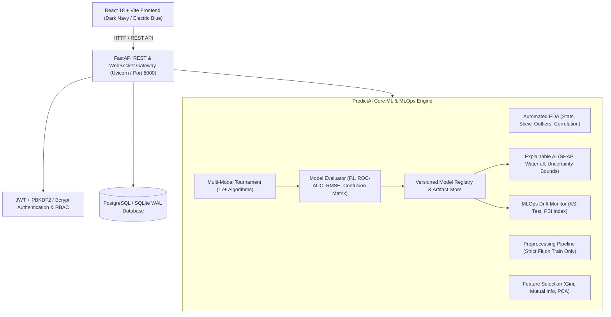
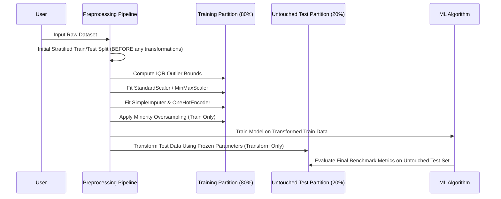

# PredictAI Pro – System Architecture & Technical Specifications

**Project Level:** Level 3 – Advanced (BTech CSE AI & ML)  
**Platform:** PredictAI Pro  
**Hardware Compatibility:** Apple Silicon ARM64 (M1/M2/M3/M4) & Linux x86_64  

---

## 1. High-Level Architecture Diagram

---

## 2. Data Leakage Prevention Architecture

Data leakage is the most critical flaw in real-world ML engineering. PredictAI Pro implements strict separation:

---

## 3. Supported Machine Learning Algorithms

| Task Modality | Implemented Algorithms | Primary Evaluation Metrics |
| :--- | :--- | :--- |
| **Classification** | Logistic Regression, Decision Tree, Random Forest, Gradient Boosting, XGBoost, Support Vector Machine (SVC), K-Nearest Neighbors, Gaussian Naive Bayes, Deep Multi-Layer Perceptron (MLP) | Accuracy, Weighted Precision, Recall, F1-Score, ROC-AUC, Confusion Matrix |
| **Regression** | Ordinary Least Squares (Linear Regression), Ridge (L2), Lasso (L1), Decision Tree Regressor, Random Forest Regressor, Gradient Boosting Regressor, XGBoost Regressor | MAE, MSE, RMSE, R² Goodness of Fit, Adjusted R², Residual Distribution |
| **Clustering** | K-Means, DBSCAN (Density-Based), Hierarchical Agglomerative Clustering | Silhouette Score, Davies-Bouldin Index, Calinski-Harabasz Index |

---

## 4. Explainable AI & Statistical Drift Mathematics

### A. Prediction Attribution
For tree models and linear models, attribution weights $A_i$ are computed:
$$A_i = \frac{x_i \cdot w_i}{\sum_j |x_j \cdot w_j|} \times 100$$
providing percentage contribution toward the inference outcome.

### B. Population Stability Index (PSI)
Used to monitor covariate drift across production inferences:
$$PSI = \sum_{k=1}^B \left( P_k - Q_k \right) \times \ln\left( \frac{P_k}{Q_k} \right)$$
* $PSI < 0.10$: Distribution Stable (Green)
* $0.10 \le PSI < 0.25$: Moderate Distribution Shift (Yellow)
* $PSI \ge 0.25$: Critical Data Drift – Action Required (Red)
